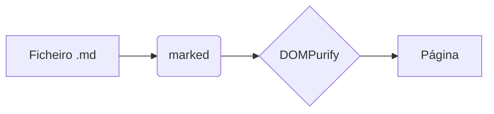

# Documento de Exemplo

Texto com **negrito**, *itálico*, ~~riscado~~, `código inline` e um [link](https://vercel.com).

## Tabela

| Funcionalidade | Estado | Notas |
|:---|:---:|---:|
| GFM | ✅ | tabelas |
| KaTeX | ✅ | $E=mc^2$ |

## Lista de tarefas

- [x] Arrastar e largar
- [ ] Publicar no Vercel

## Código

```python
def ola(nome: str) -> str:
    return f"Olá, {nome}!"
```

```js
const soma = (a, b) => a + b;
```

## Matemática

Inline: $\alpha + \beta = \gamma$ e bloco:

$$
\int_0^\infty e^{-x^2}\,dx = \frac{\sqrt{\pi}}{2}
$$

## Diagrama Mermaid



## Notas de rodapé

Uma afirmação com nota[^1].

> Citação de exemplo.

[^1]: Esta é a nota de rodapé.

<script>alert('xss')</script>
